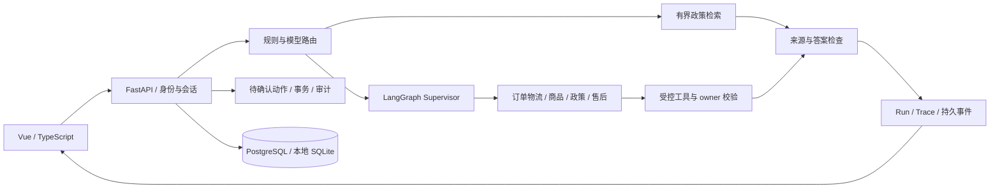

# ShopRelay

**可追溯的电商客服 Agent：政策有引用，业务查询有权限，操作有确认。**

ShopRelay是Python/Vue个人项目，将政策检索、订单与商品查询、售后流程和多节点编排连接起来。业务与政策使用合成数据；支持本地替身运行，并完成过受控的真实DeepSeek验收。不连接真实商家、物流或支付平台。

## 功能

- **任务路由**：规则与结构化模型分类配合，支持直接答复、澄清、单方面/多方面政策检索、业务Agent和拒绝。
- **来源约束**：BM25优先；复杂政策使用BGE-small、Qdrant、RRF和reranker。检查本轮引用、有效期、对象及条件。
- **专业节点协作**：LangGraph Supervisor调度订单/物流、商品、政策和售后节点，通过结构化Handoff传递结果。
- **权限与动作**：服务端认证、owner过滤、工具白名单；模拟写操作使用Pending Action、显式确认、事务和幂等检查，默认关闭。
- **执行可视化**：持久化Run、Trace和SSE事件，支持重连回放、引用查看与管理员下钻。SSE展示进度和最终结果，不模拟逐Token输出。
- **评测闭环**：分别记录工程执行、用户交付、任务质量、费用与清理，保留失败、退化和未知结果。

## 架构



| 部分 | 技术 |
|---|---|
| 后端 | Python、FastAPI、Pydantic、SQLAlchemy、Alembic |
| 编排与状态 | LangGraph、PostgreSQL Checkpointer、Run/SSE |
| 检索 | jieba/BM25、BGE-small、Qdrant、RRF、BGE reranker |
| 前端 | Vue 3、TypeScript、Vite、Element Plus |
| 工具与安全 | 可信MCP客户端、属主过滤、Pending Action |
| 验证 | pytest、前端测试、离线检查与受控真实试次 |

## 从哪里开始

1. 按[开发环境指南](docs/getting-started.md)安装依赖。
2. 先运行无需模型密钥的BM25命令行基线，再初始化本地Web Demo。
3. 阅读[架构与代码导航](docs/project-guide.md)，了解默认模式与集成模式。
4. 查看[评测结果与方法](docs/evaluation.md)，区分开发主集、定向验收与检索实验。

依赖准备好后，最小政策问答入口为：

```sh
python -m app.m0.cli ingest
python -m app.m0.cli ask "定制商品质量问题签收30天内可以退货吗"
```

这是基于合成政策的离线抽取式回答，不调用远端模型。Web、PostgreSQL和混合检索需要额外准备，详见开发环境指南。

## 已有结果

| 实验 | 结果 | 适用范围 |
|---|---|---|
| 同轮固定开发主集 | 平面工具循环A：79/100；混合策略B：83/100 | AI辅助事后预审；差4个百分点，成组区间包含0 |
| 固定24题各三次 | 三次全通过A：11/24；B：15/24 | 目的性开发样本，不是普遍架构优势 |
| 后续修复部署验收 | 8/8交付，用户采纳8项Task PASS | 锁定路径的小样本，未重测新版本全量100题 |
| 本地四路检索 | 重排的候选集合Recall@5为97.51%，BM25为93.91% | 67个独立小场景、AI相关性参考，伴随更高时延 |

这些实验使用不同版本与分母，不合并为总准确率。完整方法、负结果、成本和参考标签限制见[评测说明](docs/evaluation.md)。本地原始运行档案未作为公共数据集发布。

## 项目结构

```text
app/             API、检索、Agent、动作、记忆与图编排
frontend/        用户聊天与管理界面
knowledge/       合成政策
data/seed.json    合成业务种子
migrations/      数据库迁移
tests/           工程回归与集成测试
eval/            评测实现及历史实验材料
scripts/         开发、运行与验证工具
docs/            开发说明、公开结果及本地历史资料
```

默认本地Demo使用legacy和替身答案；LangGraph/Supervisor、真实Provider和模拟写操作各自有服务端开关。存在实现不等于默认启用。节点完成、模型回答“成功”和实际业务效果应分别核查。

## 当前限制

- 最新修复版完成过本地部署和8条路径验收；尚无新版本全量未见评测或生产容量结论。
- 语义校验仍可能误拒；回答有时冗长、内部字段偏多，交接展示投影尚有差异。
- 库存、订单与物流是数据记录；缺少观测时间时不能保证实时状态。
- 无真实支付退款、商家履约或客服平台集成。未知结果不自动重放。
- GitHub Actions提供核心检查定义；不把本地运行结果称为远端CI通过。

## 参与与发布

提交前请阅读[贡献说明](CONTRIBUTING.md)。配置使用[.env.example](.env.example)，真实凭据保存在本地忽略文件或进程环境中。

本项目采用 [MIT License](LICENSE)。第三方依赖、模型与数据遵循各自许可证。发布范围及验证结果见[发布整理记录](docs/publication-review.md)。
